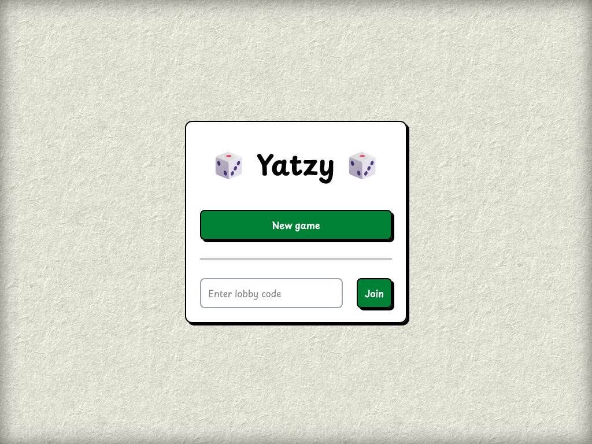

# 🎲 Yatzy

A multiplayer browser game.

**Play: [freeyatzy.com](https://freeyatzy.com/)**

Spin up a game of Yatzy quickly and easily, without logging in. Open a new room with a single click, invite others with a link, and start the game. Select the dice to roll, and mark a score. An in-game chat is included.

## Tech stack

- **React + Tailwind + Vite** front end
- **Node** back end
- **Express** for HTTP routes
- **Socket.IO** for real time communication
- **Redis** as state storage

TypeScript monorepo, npm workspaces.

The client is a single page app, and the UI is responsive and mobile-friendly. Using WebSockets, clients emit only intent and render the updated state.

The server is the only source of truth, including scores and security. Players are authenticated by a secret token issued by the server, checked once at the socket connection handshake. Tokens, IDs and dice rolls use cryptographic randomness.

The Redis database is used as state storage for games, players and timers, as well as a pub/sub adapter for sockets. This allows for scaling to multiple server instances and fast operations.

## Development setup

Requirements: Node (22+) and Redis (7+).

- Start Redis, using Docker for example:

```sh
docker run -d --name yatzy-redis -p 127.0.0.1:6379:6379 redis:8-alpine
```

- Run from repository's root:

```sh
npm install
npm run dev
```

- Open http://localhost:5173

## API and socket events

Room creation and players joining use HTTP, because sockets need a valid auth token from the beginning. This is returned from the POST join route. Everything else uses WebSockets.

### HTTP routes

| Route                             | Body       | Response                      |
| --------------------------------- | ---------- | ----------------------------- |
| `GET /api/rooms/:roomId`          |            | `{ status }`                  |
| `POST /api/rooms`                 |            | `{ roomId }`                  |
| `POST /api/rooms/:roomId/players` | `{ name }` | `{ roomId, playerId, token }` |

### Socket events

| Event          | Payload               | Direction        | Notes                                            |
| -------------- | --------------------- | ---------------- | ------------------------------------------------ |
| `game:start`   |                       | Client to server | Host only                                        |
| `turn:roll`    | `{ held: boolean[] }` | Client to server | Rolls the dice that aren't held                  |
| `turn:end`     | `{ category }`        | Client to server | Select score category and end turn               |
| `chat:send`    | `{ text }`            | Client to server | Character limit: 200                             |
| `room:leave`   |                       | Client to server | Removes player and deletes token                 |
| `room:state`   | `PublicRoomState`     | Server to client | Sent to the whole room after every change        |
| `chat:message` | `ChatMessage`         | Server to client | Not stored on server, just validated and emitted |

## Screenshots




