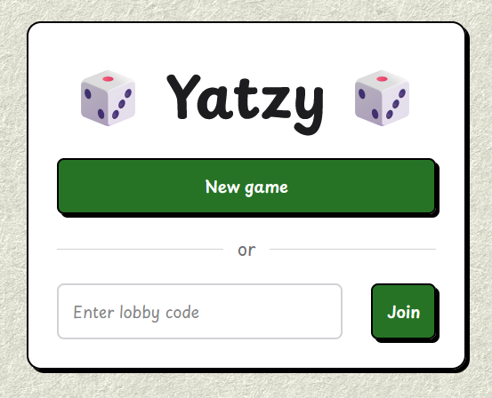
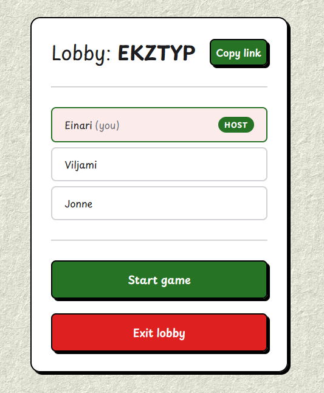
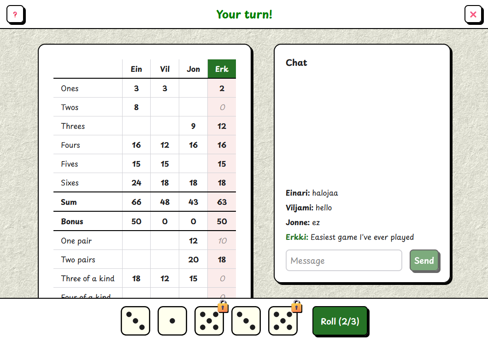

# 🎲 Yatzy

A multiplayer browser Yatzy game written in TypeScript. A monorepo using npm workspaces.

**Play: [freeyatzy.com](https://freeyatzy.com/)**

Simple and easy to use. No login. Open a new lobby with a single click, invite others via a link, and start the game. Select the dice you want to roll, and the app automatically calculates and applies your scores. A per-game chat is included.

The client is a React app, with Vite as a build tool. Clients emit only intent (never credentials), and render the received state. Players are identified by a secret token issued by the server, and authentication happens only during a socket connection handshake. The server is the only source of truth, and ID generation and all randomization use Node's crypto module.

A Redis database is used as state storage: a separate in-memory database allows for scaling to multiple server instances and fast operations.

## Tech stack

- **React + Vite + React Router** for front-end
- **Node** backend
- **Express** HTTP API
- **Socket.io** for real time communication
- **Redis** as state storage (game, players, timers)

## Setup

Requirements: Node (22.22+) and Redis (7+).

Start Redis, using Docker for example:

```sh
docker run -d --name free-yatzy-redis -p 127.0.0.1:6379:6379 redis:8-alpine
```

Run from repository's root:

```sh
npm install
npm run dev
```

## Repo structure

```
client/   Front end app: pages, components, hooks, etc.
server/   Express + Socket.IO: game engine, routes, sockets, store
shared/   Types used by both
```

## Screenshots



<!--  -->




