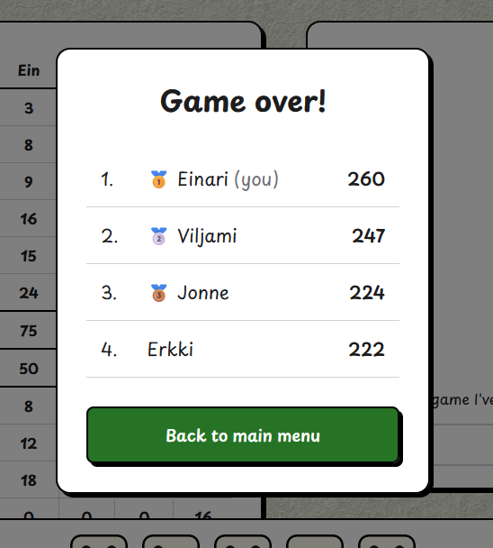

# 🎲 Yatzy

A multiplayer browser Yatzy game written in TypeScript. A monorepo using npm workspaces.

**[Play now](https://freeyatzy.com/)**

Spin up a game of Yatzy quickly and easily, without needing to log in. Open a new room with a single click, invite others via a link, and start the game. Select the dice to roll, and the game automatically calculates and applies your scores. A per-game chat is included.

### Features

The client is a React SPA, using Vite as the build tool. Using WebSockets, clients emit only intent and render the updated state.

The server is the only source of truth, including scores and security. Players are authenticated by a secret token issued by the server. Tokens, IDs and dice rolls use cryptographic randomness.

A Redis database is used as state storage for games, players and timers. A separate in-memory database allows for scaling to multiple server instances and fast operations.

## Tech stack

- **React + Vite + React Router** for front end
- **Node** back end
- **Express** for HTTP
- **Socket.io** for real time communication
- **Redis** as state storage

## Setup

Requirements: Node (22.22+) and Redis (7+).

Start Redis, using Docker for example:

```sh
docker run -d --name free-yatzy-redis -p 127.0.0.1:6379:6379 redis:8-alpine
```

Run from repository's root:

```sh
npm install
npm run dev
```

## Repo structure

```
client/   Front end app: pages, components, hooks, etc.
server/   Express + Socket.IO: game engine, routes, sockets, store
shared/   Types used by both
```

## Screenshots



