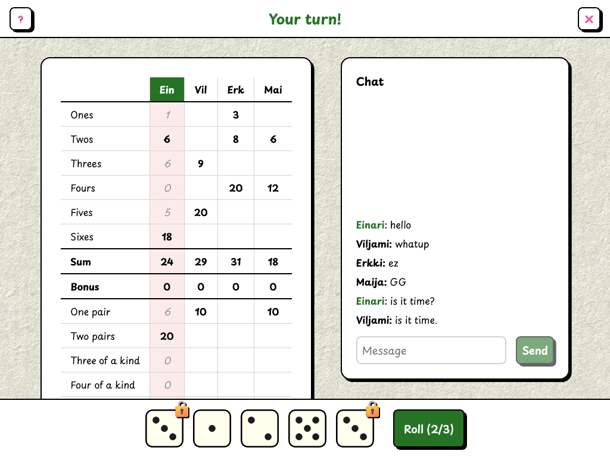

# 🎲 Yatzy

A multiplayer browser game written in TypeScript. A monorepo using npm workspaces.

**[Play now](https://freeyatzy.com/)**

Spin up a game of Yatzy quickly and easily, without needing to log in. Open a new room with a single click, invite others via a link, and start the game. Select the dice to roll, and the game automatically calculates and applies your scores. A per-game chat is included.

### Features

The client is a React single page app. Styling is done using plain CSS modules, and the layout is fully responsive. Using WebSockets, clients emit only intent and render the updated state.

The server (node, express, socket.io) is the only source of truth, including scores and security. Players are authenticated by a secret token issued by the server, and it's validated only during a socket connection handshake. Tokens, IDs and dice rolls use cryptographic randomness.

A Redis database is used as state storage for games, players and timers, as well as a pub/sub adapter for socket.io. This allows for scaling to multiple server instances and fast operations.

## Tech stack

- **React + Vite + React Router** for front end
- **Node** back end
- **Express** for HTTP
- **Socket.io** for real time communication
- **Redis** as state storage

## Setup

Requirements: Node (22.22+) and Redis (7+).

Start Redis, using Docker for example:

```sh
docker run -d --name yatzy-redis -p 127.0.0.1:6379:6379 redis:8-alpine
```

Run from repository's root:

```sh
npm install
npm run dev
```

## Flow

### HTTP routes

Room creation and players joining use HTTP, because sockets need a valid auth token from the beginning. This is returned from the POST join route.

| Route                             | Body       | Response                      |
| --------------------------------- | ---------- | ----------------------------- |
| `GET /api/rooms/:roomId`          |            | `{ status }`                  |
| `POST /api/rooms`                 |            | `{ roomId }`                  |
| `POST /api/rooms/:roomId/players` | `{ name }` | `{ roomId, playerId, token }` |

### Socket events

Everything else uses WebSockets.

| Event          | Payload               | Direction        |                                                  |
| -------------- | --------------------- | ---------------- | ------------------------------------------------ |
| `game:start`   |                       | Client to server | Host only                                        |
| `turn:roll`    | `{ held: boolean[] }` | Client to server | Rolls the dice that aren't held                  |
| `turn:end`     | `{ category }`        | Client to server | End turn and select scoring category             |
| `chat:send`    | `{ text }`            | Client to server | Character limit: 200                             |
| `room:leave`   |                       | Client to server | Removes player and wipes session                 |
| `room:state`   | `PublicRoomState`     | Server to client | Sent to the whole room after every change        |
| `chat:message` | `ChatMessage`         | Server to client | Not stored on server, just validated and emitted |

## Screenshots



